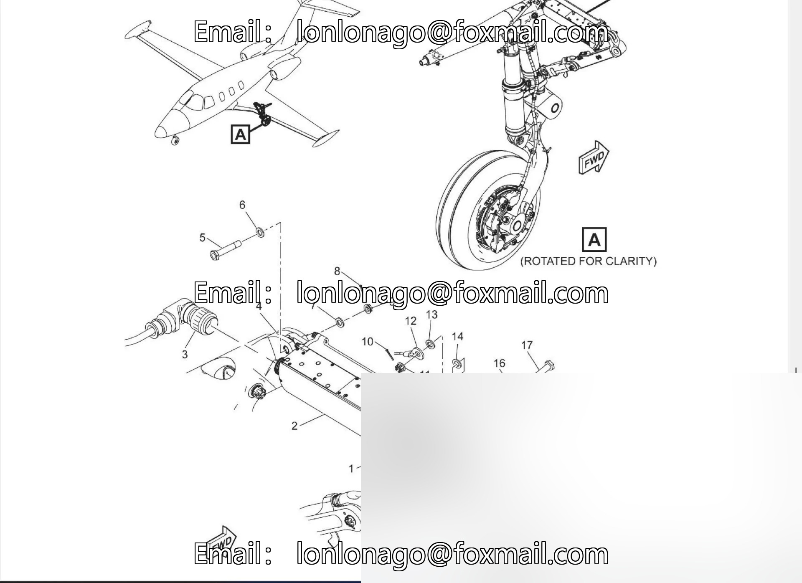
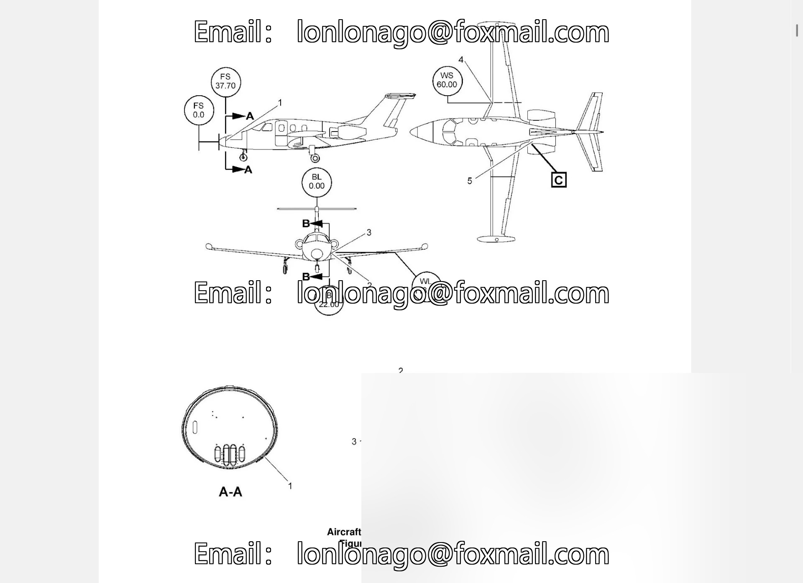
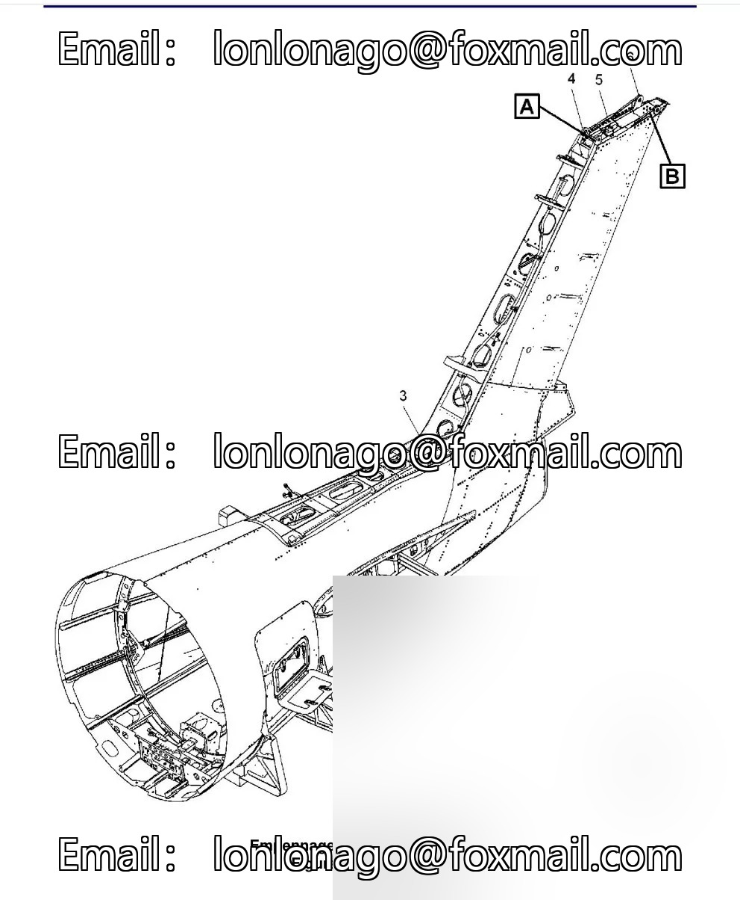
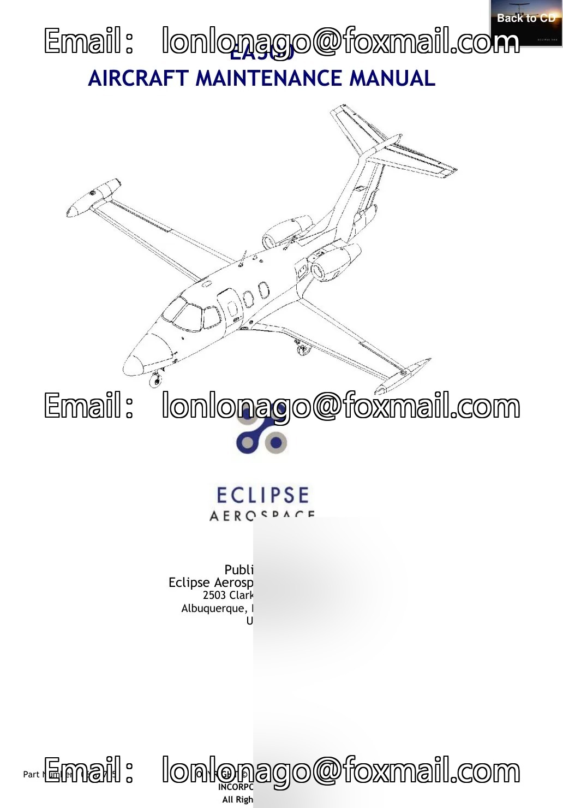

# ECLIPSE AEROSPACE (RTC Aerospace) EA500 aircraft

## Body

Eclipse Aerospace (Aerospace for Eclipse) EA500 aircraft maintenance manual, , 7000 pages.
The content covers aircraft structures, systems, maintenance procedures, etc., and is suitable for professional reference such as aviation engineering, maintenance support, and flight training.
The material is an and will not be refunded upon sale.

The manual for ECLIPSE AEROSPACE (Eclipse Aerospace) EA500 aircraft is provided; it covers aircraft structure, systems and maintenance procedures and is suitable for professional reference in aerospace engineering, maintenance assurance and flight training.

<!-- AI_ENRICHED -->

## Images

## Payment

Here is a pay link on Stripe ( https://buy.stripe.com/3cs8yP7sY87d0vu9AB ). Please contact me lonlonago@foxmail.com after funding $89, and I will send you a complete data files , thank you!

